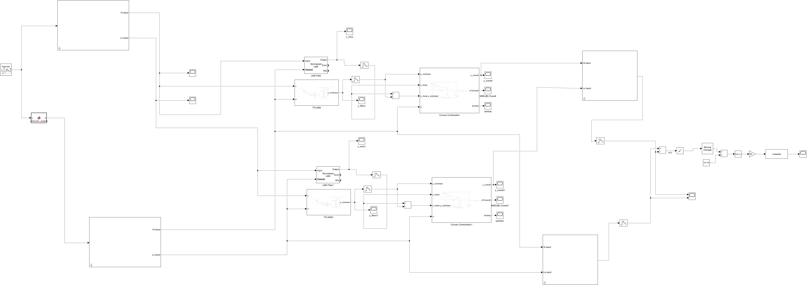
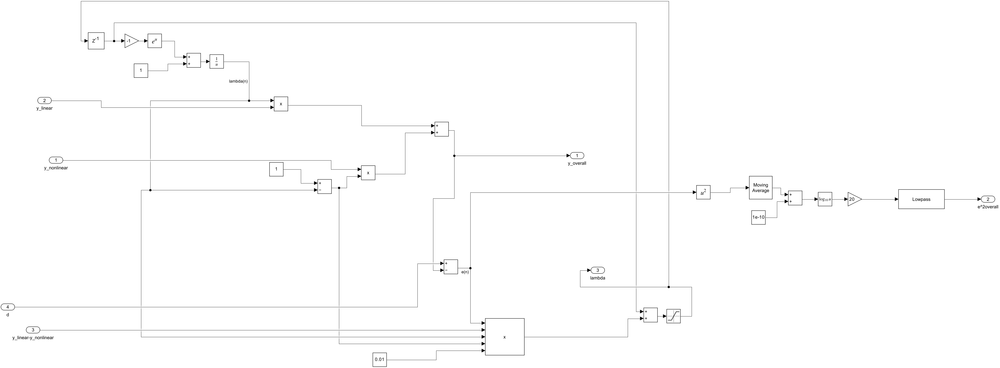

# Subband Convex Combination of Adaptive Filters for Nonlinear System Identification

Advanced Signal Processing (IIT Gandhinagar), Assignment 4 — 2026.
Authors: **Vishrut Sharma** and **Vikash Kumar Sinha**.

A Simulink model that identifies an unknown nonlinear system with a **convex combination of an
NLMS filter and a TFLANN**, run separately in **two subbands** to speed up convergence. It extends
[convex-nlms-tflann-android](https://github.com/vishrutsharma777/convex-nlms-tflann-android)
(Assignment 3), which runs the full-band version in real time on Android.

## The unknown system

A Gaussian noise source drives the `unknown_system` MATLAB Function block: a 5-tap FIR filter
followed by a static nonlinearity, plus measurement noise.

    y_lin = wᵀ x(n),   w = [0.8, −0.4, 0.2, −0.1, 0.05]
    d(n)  = y_lin + 0.2·sin(π·y_lin) − 0.1·cos(π·y_lin) + 0.0316·v(n),   v ~ N(0, 1)

The noise standard deviation 0.0316 corresponds to −30 dB.

## The model

1. **Analysis:** the input x(n) and the desired signal d(n) are each split into a high band and a
   low band with *Two-Channel Analysis Subband Filter* blocks.
2. **Per band:** each band has its own adaptive pair:
   - an *LMS Filter* block in Normalized LMS mode (linear branch);
   - a `TFLANN` subsystem (nonlinear branch);
   - a `Convex Combination` subsystem that mixes the two outputs with an adaptive λ.
3. **Synthesis:** the two band outputs, and the two bands of d(n), are recombined with
   *Two-Channel Synthesis Subband Filter* blocks.
4. **Error:** the full-band error is squared, smoothed and shown in dB.

### TFLANN subsystem (one per band)

A tap-delay line X₁(n) is expanded into X(n) = [1, X₁(n), sin(πX₁(n)), cos(πX₁(n))] and the weights
are trained with the LMS rule w(n+1) = w(n) + 2μ e(n) X(n), 2μ = 0.001.

### Convex Combination subsystem (one per band)

    λ(n) = 1 / (1 + e^(−a(n)))
    y(n) = λ(n) y_linear(n) + (1 − λ(n)) y_nonlinear(n)
    a(n+1) = sat[ a(n) + μ_a e(n) (y_linear(n) − y_nonlinear(n)) λ(n) (1 − λ(n)) ],   μ_a = 0.01

## Files

| File | What |
| --- | --- |
| `ASPA4.slx` | Simulink model |
| `images/` | Diagrams exported from the model |

## Requirements

MATLAB/Simulink with the DSP System Toolbox (LMS Filter, Two-Channel Analysis/Synthesis Subband
Filter, Lowpass Filter and Moving Average blocks).
